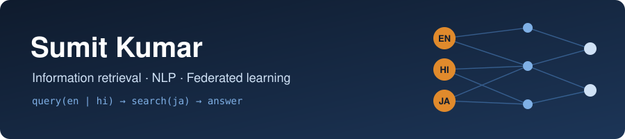

  

  
  
  

### Hi, I'm Sumit 👋

I build small, honest research prototypes in **information retrieval** and **privacy-preserving machine learning**, and I have shipped production mobile and web apps since 2023.

🔹 **Now:** measuring how much search gets worse when people ask in English or Hindi about information that exists only in Japanese 
🔹 **Also:** personalised federated learning for home sensor data, where raw data never leaves the home, and sentiment of memes in low-resource languages 
🔹 **Before:** Flutter and React developer, 4 apps live on Google Play

---

### 🔬 Research prototypes

<table>
<tr>
<td width="50%" valign="top">

**[crosslingual-search-ja](https://github.com/sumitk07/crosslingual-search-ja)** 
English / Hindi questions → Japanese passages

On 100 MIRACL-ja questions, multilingual-E5 drops from **0.818** nDCG@10 (Japanese) to **0.680** (English) and **0.644** (Hindi). Simple rank fusion with BM25 did not help.

`BM25` `multilingual-E5` `NLLB-200` `RRF` `nDCG@10`

</td>
<td width="50%" valign="top">

**[fedroutine](https://github.com/sumitk07/fedroutine)** 
Personalised federated anomaly detection for older adults living alone

On 10 simulated smart homes, FedPer matches central training (AUROC **0.844** vs 0.839) without sharing raw data. FedAvg fails on a late sleeper (**0.50**); FedPer fixes it (**0.84**).

`FedAvg` `FedPer` `autoencoder` `differential privacy` `explainability`

</td>
</tr>
<tr>
<td colspan="2" valign="top">

**[meme-sentiment-bn](https://github.com/sumitk07/meme-sentiment-bn)** 
Where does the feeling of a meme come from: the words, the picture, or both? (Bengali, MemoSen)

On 871 Bengali test memes, the image alone (CLIP, **0.539** macro-F1) is as good as the best text model (**0.541**). A multilingual sentence model reaches only **0.408**, joining text and image does not help yet, and neutral memes stay below **0.27** F1 for every model.

`CLIP` `multilingual-E5` `TF-IDF` `fusion` `macro-F1` `low-resource languages`

</td>
</tr>
</table>

Every repo has the code, the exact command to rerun it, the full results, and a section on what did **not** work.

---

### 📱 Apps I have shipped

| App | What I built | Stack |
|---|---|---|
| [Hireanything customer app](https://play.google.com/store/apps/details?id=com.hireanythingapp.hireanythingapp) | Service discovery, booking flow, in-app payments | Flutter, GetX, REST |
| [Hireanything worker / vendor app](https://play.google.com/store/apps/details?id=com.hireanything.workerapp) | Onboarding, profiles, availability management | Flutter, GetX, REST |
| [QR Buddy staff app](https://play.google.com/store/apps/details?id=com.nxtdesigns.qrbuddy_apexv3) | Task lifecycle, real-time notifications | Flutter |
| [QR Buddy consumer app](https://play.google.com/store/apps/details?id=com.nxtdesigns.qrbudddy.qrbuddy_consumer_app) | QR-based service requests | Flutter |

Company code is private. Open-source side projects: [call_app_log](https://github.com/sumitk07/call_app_log) (Flutter, Cubit) · [TalkBit](https://github.com/sumitk07/TalkBit) (Flutter, Firebase chat) · [shopeasy-data-validation](https://github.com/sumitk07/shopeasy-data-validation) (SQL data migration testing)

---

### 🧰 Tools

**Research** 
     

**Apps and web** 
      
